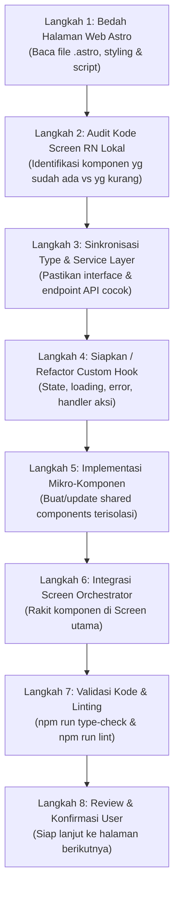

# PANDUAN DAN STANDAR PENULISAN KODE MIGRASI APLIKASI
## Porting Desain & Logika dari Web (`donasi_astro`) ke Mobile App (`donasi_app`)

---

## 1. Pendahuluan & Prinsip Utama

Dokumen ini adalah **panduan baku (blueprint)** dan alur kerja (*standard operating procedure*) resmi untuk memigrasikan seluruh antarmuka (desain) dan logika bisnis dari repositori web:
> **Repository Sumber:** `https://github.com/devkebaikan/donasi_astro/tree/beramal` (Astro v6 + Tailwind CSS)  
> **Repository Target:** `bb-mobile` (`donasi_app`) (React Native 0.86 + React 19 + TypeScript + NativeWind/StyleSheet + TanStack Query + Zustand)

### Tiga Pilar Migrasi:
1. **Desain Identik (Mobile-Adapted UX)**:
   Mengadopsi hierarki visual, warna, card elevation, typography, banner flow, dan mikro-interaksi dari versi web, namun disesuaikan secara natural dengan perilaku native mobile (Safe Area insets, pull-to-refresh, bottom sheet modal, gesture back).
2. **Logika & Flow 100% Presisi**:
   Menjaga kesesuaian endpoint API (`/home`, `/programs`, `/programs/link/:slug`, `/transactions`, `/transactions/invoice/:inv`, dll.), parameter request, validasi input form donasi, penanganan sesi pengguna (Guest vs Authenticated), kalkulasi zakat, serta flow navigasi.
3. **Arsitektur Mikro-Komponen (Micro-Component Architecture)**:
   Setiap halaman dipecah menjadi komponen-komponen kecil yang mandiri, terisolasi, dan mudah diuji. Tidak diperkenankan membuat file Screen monolitik berukuran besar (500+ baris).
4. **Pengerjaan Bertahap Per Halaman**:
   Setiap halaman dikerjakan, diuji, dan divalidasi satu per satu agar mempermudah proses debugging, review kode, dan verifikasi fungsionalitas.

---

## 2. Standar Struktur & Konvensi Penulisan Kode

### 2.1. Hirarki Folder Proyek

```text
src/
├── types/                     # Definisi Interface & Tipe TypeScript ketat (strict: true)
│   ├── home.ts                # Tipe data beranda (banner, categories, last update)
│   ├── program.ts             # Tipe program donasi, mitra, progres
│   ├── payment.ts             # Tipe transaksi, metode bayar, invoice
│   └── navigation.ts          # Tipe navigasi Native Stack & Bottom Tabs
├── config/
│   └── env.ts                 # USE_MOCK_DATA, API_BASE_URL, WA CS, Storage URL
├── services/                  # Komunikasi Jaringan & Mock Engine
│   ├── apiClient.ts           # Instance Axios dengan Auth Interceptor & Mock Switcher
│   ├── *Service.ts            # Service per modul (homeService, donationService, dsb.)
│   └── mockData/              # In-memory mock router & JSON fixtures
├── hooks/                     # Logika Bisnis & Server State (React Query / Zustand)
│   ├── useHome.ts             # Hook data beranda, banner, saldo, popup
│   ├── useDetailProgram.ts    # Hook detail campaign, donatur, kabar
│   └── useAlurDonasi.ts       # Hook kalkulasi checkout & submit transaksi
├── stores/                    # Client State Global (Zustand + AsyncStorage)
│   ├── authStore.ts           # Token & Profil User
│   └── settingStore.ts        # Preferensi font scaling, hamba Allah, dsb.
├── theme/                     # Design System Tokens
│   ├── colors.ts              # Primary (#1EB8B1), Secondary (#FD6542), Neutral
│   ├── typography.ts          # Font Montserrat & LPMQ Isep Misbah
│   ├── spacing.ts             # Skala margin & padding (xs, sm, md, lg, xl, 2xl)
│   ├── radius.ts              # Border radius standard
│   └── shadows.ts             # Elevation & shadow styles
├── components/
│   ├── ui/                    # Atomic Primitives (Button, Input, Icon, Card, Badge)
│   └── shared/                # Mikro-Komponen Domain Bisnis (HomeBanner, SaldoCard, dll.)
└── screens/                   # Screen Orchestrator (Folder per domain bisnis)
    ├── home/HomeScreen.tsx
    ├── donations/
    │   ├── AllDonationsScreen.tsx
    │   ├── DetailProgramScreen.tsx
    │   ├── AlurDonasiScreen.tsx
    │   └── PaymentInvoiceScreen.tsx
    └── ...
```

---

### 2.2. Pola Arsitektur Mikro-Komponen

Pola penulisan mengikuti pemisahan tanggung jawab (*Separation of Concerns*):

```
┌────────────────────────────────────────────────────────┐
│               SCREEN (Orchestrator Layer)              │
│  src/screens/{domain}/{Screen}.tsx                     │
│  - Tidak memuat logika kalkulasi atau fetch data liar   │
│  - Mengambil data & aksi dari Custom Hook              │
│  - Mengatur layout utama (SafeArea, ScrollView, Sheet) │
└───────────────────────────┬────────────────────────────┘
                            │
            ┌───────────────┴───────────────┐
            ▼                               ▼
┌─────────────────────────┐     ┌─────────────────────────┐
│       CUSTOM HOOK       │     │     MIKRO-KOMPONEN      │
│  src/hooks/use{Feature} │     │  src/components/shared/ │
│  - React Query data     │     │  - Komponen visual kecil│
│  - Form state / validasi│     │  - Props interface jelas│
│  - Action handlers      │     │  - Mandiri & testable   │
└───────────┬─────────────┘     └───────────┬─────────────┘
            │                               │
            ▼                               ▼
┌─────────────────────────┐     ┌─────────────────────────┐
│     SERVICE LAYER       │     │      UI PRIMITIVES      │
│  src/services/*Service  │     │  src/components/ui/     │
│  - Axios calls          │     │  - Button, Input, Icon  │
│  - Response mapper      │     │  - Reusable lintas fitur│
└─────────────────────────┘     └─────────────────────────┘
```

#### Aturan Wajib untuk Mikro-Komponen:
1. **Satu File = Satu Tanggung Jawab**: Buat komponen baru jika bagian visual memiliki kompleksitas sendiri atau berpotensi dipakai ulang (misal: `ProgramProgressBar`, `ProfileMitraCard`, `NominalOptionChips`).
2. **Prop Typing Jelas**: Selalu definisikan `interface {ComponentName}Props` dengan tipe data yang ketat. Jangan gunakan `any`.
3. **Ukuran File Terjaga**: Jaga ukuran file mikro-komponen antara 80–200 baris kode agar mudah dibaca dan di-debug.
4. **Gunakan Token Tema**: Selalu import `colors`, `spacing`, `radius`, `shadows` dari `@/theme` agar konsisten dengan palet Teal (`#1EB8B1`) dan Coral (`#FD6542`).

---

## 3. Matriks Pemetaan Halaman (Astro Web -> React Native Mobile)

Berikut adalah daftar pemetaan rute dari web Astro (`donasi_astro`) ke aplikasi mobile (`donasi_app`):

| No | Modul / Halaman | Rute Web Astro | Layar Mobile Target | Hook & Service Utama |
| :--- | :--- | :--- | :--- | :--- |
| **1** | **Beranda (Home)** | `src/pages/home.astro` | `src/screens/home/HomeScreen.tsx` | `useHome.ts`<br>`homeService.ts` |
| **2** | **Katalog Program Donasi** | `src/pages/donasi/index.astro` | `src/screens/donations/AllDonationsScreen.tsx` | `useAllDonations.ts`<br>`donationService.ts` |
| **3** | **Detail Program Donasi** | `src/pages/[slug].astro` | `src/screens/donations/DetailProgramScreen.tsx` | `useDetailProgram.ts`<br>`donationService.ts` |
| **4** | **Form Donasi (Checkout)** | `src/pages/donasi/form/[slug].astro` | `src/screens/donations/AlurDonasiScreen.tsx` | `useAlurDonasi.ts`<br>`donationService.ts` |
| **5** | **Invoice & Instruksi Bayar** | `src/pages/invoice/[slug].astro` | `src/screens/donations/PaymentInvoiceScreen.tsx` | `usePaymentInvoice.ts`<br>`donationService.ts` |
| **6** | **Infak (Online & QRIS)** | `src/pages/infak.astro` | `src/screens/donations/InfakScreen.tsx` | `useInfak.ts`<br>`infakService.ts` |
| **7** | **Zakat & Kalkulator** | `src/pages/zakat.astro` | `src/screens/zakat/ZakatScreen.tsx`<br>`src/screens/zakat/ZakatKalkulatorScreen.tsx` | `useZakat.ts`<br>`useZakatKalkulator.ts` |
| **8** | **Donasi Rutin (Subscription)** | `src/pages/donasi-rutin/index.astro`<br>`.../form-rutin/[slug].astro` | `src/screens/myDonations/RecurringDonationScreen.tsx`<br>`src/screens/donations/DonasiRutinSetupScreen.tsx` | `useRecurringProgramList.ts`<br>`useDonasiRutinSetup.ts` |
| **9** | **Donasi Saya (Riwayat)** | `src/pages/donasi-saya/index.astro`<br>`.../riwayat-donasi.astro` | `src/screens/myDonations/MyDonationsScreen.tsx` | `useMyDonations.ts`<br>`donationService.ts` |
| **10**| **Autentikasi Pengguna** | `src/pages/auth/login.astro`<br>`.../register.astro`, `otp.astro` | `src/screens/auth/LoginScreen.tsx`<br>`RegisterScreen.tsx`, `OtpScreen.tsx` | `useLogin.ts`<br>`useRegister.ts` |
| **11**| **Akun & Profil Donatur** | `src/pages/akun.astro`<br>`src/pages/me.astro` | `src/screens/account/AccountScreen.tsx`<br>`MyProfileScreen.tsx`, `EditProfileScreen.tsx` | `useAccount.ts`<br>`useMyProfile.ts` |
| **12**| **Top Up & Mutasi Saku** | `src/pages/top-up.astro`<br>`src/pages/mutasi-saku.astro` | `src/screens/topup/TopupScreen.tsx`<br>`MutasiSakuScreen.tsx` | `useTopup.ts`<br>`walletService.ts` |
| **13**| **Tracking & Laporan Bantuan**| `src/pages/track-donation/[slug].astro`<br>`.../report/[slug].astro` | `src/screens/donations/TrackingScreen.tsx`<br>`DistributionReportScreen.tsx` | `useTrackingDetail.ts`<br>`useDistributionReport.ts` |
| **14**| **Informasi & Legalitas** | `src/pages/tentang.astro`<br>`kontak.astro`, `rekening.astro` | `src/screens/account/AboutScreen.tsx`<br>`ContactScreen.tsx`, `RekeningScreen.tsx` | `appService.ts` |

---

## 4. Rincian Spesifikasi & Flow Logika Per Halaman

---

### Halaman 1: Beranda (Home)
- **Sumber Web:** `tmp/donasi_astro/src/pages/home.astro`
- **Target Mobile:** `src/screens/home/HomeScreen.tsx`
- **Hook Pendukung:** `src/hooks/useHome.ts`, `src/hooks/useHomeBackground.ts`
- **Service:** `src/services/homeService.ts` (`GET /pages/home`)

#### 1. Komposisi Desain Visual (Web Layout)
1. **Header**: Logo Beramalbersama, Animated Typing Search Bar, Notifikasi Bell + Badge, Menu Burger drawer.
2. **Hero Section**:
   - Carousel Banner Utama (`banner_slides` / `main_banner`) dengan indikator titik.
   - Kartu Mengambang "Saldo Saku Kebaikan" (`-mt-5` di atas banner): Menampilkan nominal saldo donatur jika login, atau status bintang/tombol Masuk jika belum login, serta tombol Top Up.
3. **Menu Utama 4 Icon**:
   - Donasi (`/donasi`), Infak (`/infak`), Zakat (`/zakat`), Donasi Rutin (`/donasi-rutin`, dengan badge "NEW").
4. **Banner Kedua (Image Promosi 1)**: Banner lebar dengan link tujuan program.
5. **Program Pilihan (`ProgramSection`)**: Horizontal card scroll program mendesak/prioritas dengan progress bar, nominal tercapai, dan sisa hari.
6. **Banner Ketiga (Image Promosi 2)**: Banner penunjang.
7. **Proyek Kebaikan (`ProjectListSection`)**: Proyek penyaluran yang telah terlaksana dengan status dan lokasi.
8. **Banner Slider Sekunder (`SliderBanner`)**: Carousel banner horizontal sekunder.
9. **Kategori & Program Rutin (`ProgramListSection`)**: Tab kategori pill + vertikal list program donasi.
10. **Ticker Notifikasi Donatur (`DonorNotifSection`)**: Live pill notifikasi donasi masuk di sudut layar.

#### 2. Logika & State Flow
- **Data Source**: Request ke endpoint `GET /pages/home`.
- **Saldo Saku**: Jika user berstatus login (`accessToken != null`), lakukan fetch ke `GET /dashboard/donatur/my-account`. Jika guest, tampilkan `*******` dan tombol navigasi ke `LoginScreen`.
- **Pull to Refresh**: Me-refresh data beranda (`refetch`) dan saldo saku secara bersamaan.
- **Klik Banner**: Mendeteksi apakah link merupakan URL external atau slug program (`/program-slug`), lalu buka di WebView atau navigate ke `DetailProgramScreen`.

#### 3. Dekomposisi Mikro-Komponen
- `HomeHeader.tsx`: Logo, search pill, tombol notifikasi, tombol menu drawer.
- `HomeBannerSlider.tsx`: Auto-scrolling carousel banner utama dengan pagination dot.
- `SaldoSakuCard.tsx`: Kartu Saku Kebaikan dengan format Rupiah dan tombol aksi (Top Up / Masuk).
- `MenuUtamaGrid.tsx`: Grid 4 menu utama (Donasi, Infak, Zakat, Rutin).
- `ProgramPilihanCarousel.tsx`: Horizontal scroll list program donasi pilihan.
- `ProjectListSection.tsx`: Laporan pelaksanaan proyek donasi dengan foto dan mitra.
- `CategoryProgramTabs.tsx`: Tab filter kategori program dengan list vertikal card.
- `DonorLiveTicker.tsx`: Komponen animasi toast notifikasi donasi terbaru.

---

### Halaman 2: Katalog Program Donasi (Program Catalog)
- **Sumber Web:** `tmp/donasi_astro/src/pages/donasi/index.astro`
- **Target Mobile:** `src/screens/donations/AllDonationsScreen.tsx`
- **Hook Pendukung:** `src/hooks/useAllDonations.ts`
- **Service:** `src/services/donationService.ts` (`GET /programs`)

#### 1. Komposisi Desain Visual
1. **Header Search**: Search bar aktif dengan auto-focus / debounced input dan tombol back.
2. **Category Filter Pills**: Bar horizontal scrollable berisi tombol "Semua" dan kategori-kategori (Kemanusiaan, Pendidikan, Kesehatan, dll.).
3. **List Program Cards**: Kartu program vertikal:
   - Gambar thumbnail program (16:9).
   - Judul program (maksimal 2 baris truncated).
   - Nama lembaga mitra + verifikasi centang.
   - Progress bar donasi (persentase capaian).
   - Info terkumpul (Rp) dan sisa hari / target waktu.
4. **Loading & Empty State**: Shimmer card skeleton saat memuat; ilustrasi & pesan saat program tidak ditemukan.

#### 2. Logika & State Flow
- **Params**: `category` (slug/id), `search` (string), `page` (number), `limit` (number).
- **Infinite Scrolling**: Otomatis memuat halaman berikutnya saat scroll mencapai 80% daftar (`onEndReached`).
- **Debounced Search**: Tunggu 400ms setelah user selesai mengetik sebelum mengeksekusi request ke backend.

#### 3. Dekomposisi Mikro-Komponen
- `CatalogHeaderSearch.tsx`: Bar pencarian khusus katalog dengan tombol clear (X).
- `CategoryPillList.tsx`: Kumpulan chip kategori horizontal dengan state aktif.
- `ProgramVerticalCard.tsx`: Kartu program ringkas standar katalog.
- `ProgramCatalogSkeleton.tsx`: Efek shimmer saat fetch data katalog.

---

### Halaman 3: Detail Program Donasi
- **Sumber Web:** `tmp/donasi_astro/src/pages/[slug].astro` & `components/sections/donasi/*`
- **Target Mobile:** `src/screens/donations/DetailProgramScreen.tsx`
- **Hook Pendukung:** `src/hooks/useDetailProgram.ts`
- **Service:** `src/services/donationService.ts` (`GET /programs/link/:slug`)

#### 1. Komposisi Desain Visual
1. **Top Header**: Tombol kembali transparan/solid on scroll, judul pendek, tombol bagikan (Share).
2. **Media Hero**: Banner gambar utama program / video.
3. **Header Informasi**:
   - Judul lengkap program donasi.
   - Nominal tercapai, target donasi, persentase capaian, jumlah donatur, sisa hari.
   - Kartu Profil Mitra Lembaga (avatar, nama, lokasi, status verifikasi).
4. **Tab Bar Segmented**:
   - Tab 1: **Cerita (Story)** — Teks narasi penggalangan dana, gambar pendukung, dan rincian ajakan.
   - Tab 2: **Kabar Terbaru (Report)** — Update berkala penyaluran dan kabar lapangan.
   - Tab 3: **Donatur (Donors)** — Daftar riwayat donatur (nama / hamba Allah, nominal, doa, waktu).
   - Tab 4: **Rincian Dana (Funds)** — Transparansi pos anggaran penggunaan dana donasi.
5. **Sticky Bottom Donate Bar**: Bar mengambang di dasar layar dengan tombol "Donasi Sekarang" dan tombol "Bagikan".
6. **Share Modal Sheet**: Opsi membagikan link ke WhatsApp, Salin Link, Facebook, Twitter/X.

#### 2. Logika & State Flow
- **Parallel Fetching**: Fetch detail campaign (`getCampaignByLink`), donatur (`getDonorsByLink`), dan laporan penyaluran (`getReportByLink`) secara simultan dengan `Promise.allSettled`.
- **Target Nominal**: Jika `is_target_nominal === false`, tampilkan label "Target Waktu" tanpa batas target dana.
- **Handling Campaign Expired**: Jika sisa hari sudah habis atau campaign dinonaktifkan, tombol "Donasi Sekarang" di-disable dengan label "Penggalangan Dana Ditutup".

#### 3. Dekomposisi Mikro-Komponen
- `DetailProgramHeader.tsx`: Header dengan efek animasi transparansi sesuai offset scroll.
- `ProgramHeroMedia.tsx`: Gambar utama program dengan badge kategori.
- `ProgramStatSummary.tsx`: Informasi capaian nominal, target, persentase, dan sisa hari.
- `MitraProfileCard.tsx`: Profil penyelenggara program donasi.
- `ProgramDetailTabs.tsx`: Tab navigasi segmented (Cerita, Kabar, Donatur, Rincian).
- `ProgramStoryView.tsx`: Komponen render konten cerita (rich text / HTML sanitize).
- `ProgramReportList.tsx`: Daftar timeline kabar penyaluran dana.
- `ProgramDonorsList.tsx`: List donatur beserta doa/harapan donatur.
- `StickyDonateBar.tsx`: Bar aksi bawah dengan tombol CTA utama.
- `ShareBottomSheet.tsx`: Modal pop-up share link dan teks ajakan.

---

### Halaman 4: Form Donasi / Checkout
- **Sumber Web:** `tmp/donasi_astro/src/pages/donasi/form/[slug].astro`
- **Target Mobile:** `src/screens/donations/AlurDonasiScreen.tsx`
- **Hook Pendukung:** `src/hooks/useAlurDonasi.ts`, `src/hooks/usePaymentMethodSelection.ts`
- **Service:** `src/services/donationService.ts` (`POST /transactions`, `GET /payment/payment-method`)

#### 1. Komposisi Desain Visual
1. **Header Form**: "Konfirmasi Donasi" / "Konfirmasi Zakat" dengan tombol kembali.
2. **Ringkasan Program**: Mini card berisi thumbnail program dan judul donasi terpilih.
3. **Pilihan Nominal Donasi**:
   - Quick Chips: Pilihan cepat (Rp 10.000, Rp 25.000, Rp 50.000, Rp 100.000, dst.).
   - Input Nominal Kustom: Input angka dengan prefix otomatis `Rp` dan formatting ribuan.
   - Peringatan Minimal Donasi: Min. Rp 10.000 (atau Rp 100.000 jika dari sumber iklan/ads).
4. **Data Diri Donatur**:
   - Jika sudah Login: Otomatis terisi nama & nomor HP user.
   - Jika Guest: Input Nama Lengkap & Nomor WhatsApp aktif.
   - Switch "Sembunyikan nama saya (Hamba Allah)".
   - Switch "Donasi atas nama orang lain" (opsional: input nama yang diniatkan).
5. **Doa & Dukungan**: Textarea opsional untuk menuliskan doa kebaikan.
6. **Metode Pembayaran**:
   - Pemilih metode aktif: Saku Kebaikan (Dompet), Virtual Account (BCA, Mandiri, BNI, BRI, BSI), QRIS, Transfer Bank, E-Wallet (GoPay, OVO, ShopeePay).
   - Bottom Sheet Pilihan Metode: Menampilkan biaya admin, logo metode, dan status saldo saku.
7. **Tombol Konfirmasi**: "Lanjut Pembayaran" dengan total nominal lengkap.

#### 2. Logika & State Flow
- **Validasi Ketat**:
  - Nominal harus $\ge$ batas minimal donasi.
  - Nama dan nomor WhatsApp wajib diisi bila belum login.
  - Jika metode pembayaran adalah Saku Kebaikan, saldo harus mencukupi.
- **Payload Transaksi (`POST /transactions`)**:
  ```typescript
  {
    type: "donation",
    program_type: "infaq",
    items: [programId],
    total: [amount],
    payment_method_id: paymentMethodId,
    name: isAnonymous ? "Hamba Allah" : name,
    phone: phone,
    doa: prayerText,
    other_detail: onBehalfName,
    reff_code: reffCode,
    status: "Pending"
  }
  ```
- **Redirect Response**: Mengambil string `invoice` dari response data (`data.data.invoice`), lalu navigate ke `PaymentInvoiceScreen`.

#### 3. Dekomposisi Mikro-Komponen
- `CheckoutProgramHeader.tsx`: Kartu ringkas program yang didonasi.
- `NominalSelectionGrid.tsx`: Grid pilihan nominal cepat + input nominal bebas.
- `DonorIdentityForm.tsx`: Input field nama, WhatsApp, switch hamba Allah.
- `OnBehalfSection.tsx`: Form input donasi atas nama orang tua / kerabat.
- `PrayerInputCard.tsx`: Kotak input doa dan harapan donatur.
- `PaymentMethodSelector.tsx`: Bar pemicu bottom sheet metode bayar terpilih.
- `PaymentMethodBottomSheet.tsx`: Modal pengelompokan metode pembayaran.
- `CheckoutBottomBar.tsx`: Bar dasar berisi ringkasan total dan tombol submit.

---

### Halaman 5: Invoice & Pembayaran
- **Sumber Web:** `tmp/donasi_astro/src/pages/invoice/[slug].astro`
- **Target Mobile:** `src/screens/donations/PaymentInvoiceScreen.tsx`
- **Hook Pendukung:** `src/hooks/usePaymentInvoice.ts`
- **Service:** `src/services/donationService.ts` (`GET /transactions/invoice/:inv`)

#### 1. Komposisi Desain Visual
1. **Header Invoice**: "Instruksi Pembayaran" dengan tombol kembali ke Beranda.
2. **Status Card**:
   - Status: "Menunggu Pembayaran" (Kuning), "Berhasil / Lunas" (Hijau), "Dibatalkan / Kedaluwarsa" (Merah).
   - Countdown Timer batas akhir pembayaran (misal: 23 jam 59 menit).
3. **Rincian Nominal**:
   - Nominal Donasi dasar + Kode Unik transaksi.
   - Total Transfer yang harus dibayarkan (dengan tombol "Salin Nominal").
4. **Detail Metode Pembayaran**:
   - **Jika QRIS**: Menampilkan gambar QR Code dinamis (`react-native-qrcode-svg`) dengan tombol "Unduh / Simpan QR" dan "Bagikan QR".
   - **Jika Virtual Account / Transfer Bank**: Menampilkan Logo Bank, Nomor Rekening / VA, Nama Penerima, dan tombol "Salin Nomor Rekening".
5. **Panduan / Tata Cara Pembayaran (Accordion)**:
   - Petunjuk transfer via Mobile Banking, Internet Banking, dan ATM.
6. **Tombol Aksi**:
   - "Cek Status Pembayaran" (refresh status transaksi).
   - "Bantuan / Konfirmasi WhatsApp" (membuka link direct WhatsApp CS).

#### 2. Logika & State Flow
- **Data Source**: Fetch detail invoice via `GET /transactions/invoice/:slug`.
- **Deteksi Jenis Pembayaran**:
  - `isQris = payment.bank === 'Qris'` -> Generate QR dari `third_party_detail.qr_string`.
  - `isVA = !!(thirdPartyDetail.account_number && thirdPartyDetail.bank_code)`.
- **Clipboard Utility**: Tombol Salin memicu `Clipboard.setString()` disertai Toast feedback "Nomor rekening berhasil disalin".
- **Auto Check / Polling**: Mendukung manual refetch saat pengguna menekan tombol "Cek Status".

#### 3. Dekomposisi Mikro-Komponen
- `InvoiceStatusBanner.tsx`: Badge status transaksi dan hitung mundur waktu transfer.
- `InvoiceTotalAmountCard.tsx`: Tampilan nominal total beserta highlight kode unik.
- `InvoiceBankDetailsCard.tsx`: Tampilan VA / Rekening Bank dengan tombol salin.
- `InvoiceQrisDisplayCard.tsx`: Render SVG QRIS Code dengan tombol unduh QR.
- `InvoiceInstructionsAccordion.tsx`: Accordion panduan pembayaran per bank/channel.
- `InvoiceActionFooter.tsx`: Tombol cek status dan tombol WhatsApp CS.

---

### Halaman 6: Infak & Sedekah
- **Sumber Web:** `tmp/donasi_astro/src/pages/infak.astro`
- **Target Mobile:** `src/screens/donations/InfakScreen.tsx`
- **Hook Pendukung:** `src/hooks/useInfak.ts`

#### 1. Komposisi Desain Visual
1. **Tab Navigasi 3 Pilihan**:
   - Tab 1: **Infak Online** — Form cepat donasi infak dengan nominal pilihan.
   - Tab 2: **QRIS Infak** — Tampilan statis QRIS resmi lembaga untuk scan cepat.
   - Tab 3: **Daftar Donatur** — Riwayat penyalur infak terkini.
2. **Kutipan / Hadist Keutamaan Infak**: Card pengingat fadhilah sedekah.

---

### Halaman 7: Zakat & Kalkulator Zakat
- **Sumber Web:** `tmp/donasi_astro/src/pages/zakat.astro`
- **Target Mobile:** `src/screens/zakat/ZakatScreen.tsx` & `src/screens/zakat/ZakatKalkulatorScreen.tsx`
- **Hook Pendukung:** `src/hooks/useZakat.ts`, `src/hooks/useZakatKalkulator.ts`
- **Service:** `src/services/zakatService.ts` (`GET /zakat/nishab`)

#### 1. Komposisi Desain Visual & Logika
1. **Tabs Jenis Zakat**: Zakat Penghasilan (Profesi), Zakat Maal (Harta Simpanan), Zakat Fitrah.
2. **Kalkulator Zakat Otomatis**:
   - Mengambil acuan harga emas & nisab resmi dari backend (`/zakat/nishab`).
   - Perhitungan Zakat Penghasilan: $(\text{Penghasilan Bulanan} + \text{Pendapatan Lain} - \text{Hutang/Cicilan}) \times 2.5\%$.
   - Indikator Status Wajib Zakat: Menampilkan apakah harta sudah mencapai nishab atau belum.
3. **Niat Zakat**: Teks bacaan niat zakat dalam bahasa Arab, latin, dan terjemahan.
4. **Tombol Aksi**: "Tunaikan Zakat Sekarang" langsung membawa hasil hitung ke form checkout donasi zakat.

---

### Halaman 8: Donasi Rutin (Autodebit / Subscription)
- **Sumber Web:** `tmp/donasi_astro/src/pages/donasi-rutin/*`
- **Target Mobile:** `src/screens/myDonations/RecurringDonationScreen.tsx`, `DonasiRutinSetupScreen.tsx`
- **Hook Pendukung:** `src/hooks/useRecurringProgramList.ts`, `useDonasiRutinSetup.ts`

#### 1. Komposisi Desain Visual & Logika
1. **Beranda Rutin**: Banner motivasi sedekah subuh / rutin, kalender streak komitmen donasi harian.
2. **Pilihan Program Rutin**: Katalog program yang mendukung autodebit / pengingat rutin.
3. **Setup Form Rutin**: Pilihan frekuensi (Harian, Mingguan, Bulanan), pilihan hari/tanggal, pilihan jam pengingat, dan nominal komitmen.

---

### Halaman 9: Donasi Saya (Dashboard & Riwayat)
- **Sumber Web:** `tmp/donasi_astro/src/pages/donasi-saya/*`
- **Target Mobile:** `src/screens/myDonations/MyDonationsScreen.tsx`
- **Hook Pendukung:** `src/hooks/useMyDonations.ts`

#### 1. Komposisi Desain Visual & Logika
1. **Ringkasan Dampak**: Total dana kebaikan yang telah disalurkan, jumlah program terbantu.
2. **Kalender Kebaikan**: Rekam jejak tanggal kapan saja user berdonasi.
3. **Filter Status Transaksi**: Tab Segmented: "Semua", "Menunggu Pembayaran", "Berhasil", "Dibatalkan".
4. **Kartu Riwayat Donasi**: Thumbnail program, nominal, tanggal, status badge, tombol lihat invoice / unduh bukti donasi.

---

### Halaman 10: Akun, Saldo Saku & Top Up
- **Sumber Web:** `tmp/donasi_astro/src/pages/akun.astro`, `top-up.astro`, `mutasi-saku.astro`
- **Target Mobile:** `src/screens/account/AccountScreen.tsx`, `TopupScreen.tsx`, `MutasiSakuScreen.tsx`
- **Hook Pendukung:** `src/hooks/useAccount.ts`, `useTopup.ts`

#### 1. Komposisi Desain Visual & Logika
1. **Header Akun**: Avatar profil, nama user, nomor handphone, status verifikasi.
2. **Card Saku Kebaikan**: Saldo aktif, tombol "Top Up Saldo", tautan "Riwayat Mutasi Saldo".
3. **Menu Pengaturan & Bantuan**:
   - Donasi Rutin Saya, Riwayat Donasi Saya, Ubah Kata Sandi.
   - Rekening Donasi Resmi, Tentang Kami, Syarat & Ketentuan, Hubungi CS WhatsApp.
   - Tombol Keluar (Logout) dengan modal konfirmasi.

---

### Halaman 11: Autentikasi (Login, Register, OTP, Lupa Password)
- **Sumber Web:** `tmp/donasi_astro/src/pages/auth/*`
- **Target Mobile:** `src/screens/auth/LoginScreen.tsx`, `RegisterScreen.tsx`, `OtpScreen.tsx`
- **Hook Pendukung:** `src/hooks/useLogin.ts`, `useRegister.ts`

#### 1. Komposisi Desain Visual & Logika
1. **Login**: Input Nomor WhatsApp atau Email + Password; tombol "Masuk via OTP WhatsApp".
2. **Register**: Input Nama Lengkap, Nomor WhatsApp, Email, dan Buat Kata Sandi.
3. **Verifikasi OTP**: Input 4 atau 6 digit kode OTP dengan countdown hitung mundur kirim ulang.

---

## 5. SOP Alur Kerja Pengerjaan Per Halaman (Step-by-Step Workflow)

Setiap kali memulai atau mengerjakan suatu halaman, ikuti langkah-langkah terstruktur berikut:



### Rincian Tiap Langkah:
- **Langkah 1 (Bedah Halaman Astro)**: Periksa layout `.astro`, CSS class Tailwind, endpoint API yang dipanggil di frontmatter/script, dan handling interaksi klien.
- **Langkah 2 (Audit Lokal)**: Periksa file screen RN di `src/screens/`. Identifikasi apakah ada elemen visual web yang belum ada di mobile atau ada komponen lama yang tidak sesuai lagi dengan Astro.
- **Langkah 3 (Type & Service Layer)**: Tambahkan tipe baru di `src/types/` dan function di `src/services/`. Pastikan dukungan mode offline (`USE_MOCK_DATA`) tetap berjalan.
- **Langkah 4 (Custom Hook)**: Tulis atau sesuaikan hook di `src/hooks/`. Pastikan seluruh state (loading, error, refreshing, data, handlers) ter-ekspos dengan rapi.
- **Langkah 5 (Mikro-Komponen)**: Tulis komponen presentasional di `src/components/shared/` atau `src/components/ui/`. Gunakan token warna dari `@/theme` dan dukung accessibility scaling.
- **Langkah 6 (Integrasi Screen)**: Hubungkan mikro-komponen di dalam Screen. Gunakan `ScrollView` dengan `RefreshControl` untuk halaman berbasis katalog/feed.
- **Langkah 7 (Validasi Teknis)**: Jalankan perintah:
  ```bash
  npm run type-check
  npm run lint
  ```
  Pastikan **0 error TypeScript** sebelum melaporkan ke user.
- **Langkah 8 (Konfirmasi)**: Berikan laporan hasil pengerjaan halaman kepada pengguna dan tunggu perintah untuk halaman selanjutnya.

---

## 6. Checklist Debugging & Quality Assurance (QA) Per Halaman

Sebelum suatu halaman dinyatakan selesai, wajib memeriksa checklist berikut:

- [ ] **Desain & Kesesuaian Visual**:
  - Warna konsisten dengan tema: Teal (`colors.primary[500] = #1EB8B1`) dan Coral (`colors.secondary[500] = #FD6542`).
  - Spacing, margin, padding simetris dan rapi.
  - Border radius kartu dan tombol konsisten (`radius.lg` atau `radius.full`).
- [ ] **Safe Area & Layar Responsif**:
  - Top inset di-handle dengan `useSafeAreaInsets().top` (tidak tertutup notch/status bar).
  - Bottom inset di-handle dengan benar (tidak tertutup gesture bar iOS/Android).
- [ ] **State Handling Lengkap**:
  - **Loading State**: Shimmer skeleton atau loading spinner muncul saat fetch data.
  - **Empty State**: Pesan jelas & ilustrasi jika data kosong (misal: "Belum ada donasi").
  - **Error State**: Pesan error ramah pengguna disertai tombol "Coba Lagi" (retry).
  - **Refresh State**: `RefreshControl` berfungsi mulus saat ditarik ke bawah.
- [ ] **Navigasi & Interaktivitas**:
  - Tombol kembali (Back) berfungsi dan tidak menyebabkan blank screen.
  - Tautan internal (slug) membuka halaman yang sesuai di tumpukan navigasi stack.
  - Tautan eksternal membuka browser / WhatsApp dengan aman.
- [ ] **Kualitas Kode**:
  - Tidak ada kode monolitik (semua section kompleks dipecah jadi mikro-komponen).
  - Tidak ada tipe `any` yang tidak perlu di TypeScript.
  - Kompilasi `npm run type-check` lulus tanpa error.

---

## 7. Rekomendasi Urutan Eksekusi Halaman

Sesuai instruksi untuk mengerjakan **per halaman** secara berurutan guna mempermudah debugging:

1. **Halaman 1: Beranda (`HomeScreen.tsx`)** *(Core Discovery)*  
   *Menyelaraskan header, hero banner slider, saldo saku card, menu utama 4 icon, banner promosi, program pilihan, project list, dan live ticker.*
2. **Halaman 2: Katalog Program Donasi (`AllDonationsScreen.tsx`)** *(Discovery & Filtering)*  
   *Menyelaraskan search bar, category pills, infinite scroll program card list, dan empty/skeleton states.*
3. **Halaman 3: Detail Program Donasi (`DetailProgramScreen.tsx`)** *(Program Content)*  
   *Menyelaraskan banner media, profil mitra, 4 tab (Cerita, Kabar, Donatur, Rincian Dana), sticky bottom donate bar, dan modal share.*
4. **Halaman 4: Form Donasi / Checkout (`AlurDonasiScreen.tsx`)** *(Checkout Flow)*  
   *Menyelaraskan nominal options (chip + manual), identitas donatur (auth vs guest), opsi hamba Allah, doa, dan modal metode bayar.*
5. **Halaman 5: Invoice & Pembayaran (`PaymentInvoiceScreen.tsx`)** *(Post-Checkout Flow)*  
   *Menyelaraskan status pembayaran, countdown batas waktu, QRIS generator, nomor VA/rekening, tombol salin, dan petunjuk transfer.*
6. **Halaman 6: Infak (`InfakScreen.tsx`)** *(Secondary Philanthropy)*  
   *Menyelaraskan tab Infak Online, QRIS infak, dan daftar donatur infak.*
7. **Halaman 7: Zakat & Kalkulator Zakat (`ZakatScreen.tsx` & `ZakatKalkulatorScreen.tsx`)**  
   *Menyelaraskan kalkulator zakat penghasilan & maal, penarikan nisab emas dari backend, dan checkout zakat.*
8. **Halaman 8: Donasi Rutin (`RecurringDonationScreen.tsx`, `DonasiRutinSetupScreen.tsx`)**  
   *Menyelaraskan kalender streak komitmen rutin, katalog program rutin, dan setup autodebit.*
9. **Halaman 9: Donasi Saya (`MyDonationsScreen.tsx`)**  
   *Menyelaraskan dashboard kebaikan donatur, kalender jejak donasi, dan riwayat transaksi bertab status.*
10. **Halaman 10: Akun, Saldo & Top Up (`AccountScreen.tsx`, `TopupScreen.tsx`, `MutasiSakuScreen.tsx`)**  
    *Menyelaraskan profil donatur, saldo dompet kebaikan, form topup, dan daftar mutasi saldo.*
11. **Halaman 11: Autentikasi (`LoginScreen.tsx`, `RegisterScreen.tsx`, `OtpScreen.tsx`)**  
    *Menyelaraskan login WhatsApp/email, registrasi donatur, verifikasi OTP, dan ganti kata sandi.*
12. **Halaman 12: Halaman Informasi & Pendukung (`TrackingScreen.tsx`, `AboutScreen.tsx`, `RekeningScreen.tsx`)**  
    *Menyelaraskan pelacakan bantuan, profil lembaga mitra, daftar rekening resmi, dan syarat ketentuan.*

---
*Dokumen ini siap digunakan sebagai acuan baku pengerjaan per halaman.*

